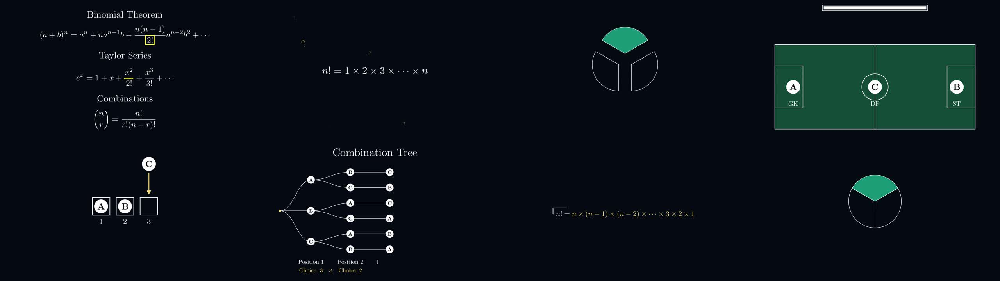

# উদাহরণ: Factorial ভিডিও (শেষ হওয়া কাজ)

এটা এই package-এর পদ্ধতিতে সত্যিই তৈরি হওয়া একমাত্র সম্পূর্ণ উদাহরণ।
নতুন ভিডিওর সময় সংখ্যা, ফাইলের নাম আর ধাপ মেলাতে এটাই মাপকাঠি।



## এই folder-এ কী আছে

| জিনিস | কোথায় |
|---|---|
| মুখে বলার ভাষায় রূপান্তরিত narration | `narration_segments.json` |
| Segment-এর ক্রম ও music মান | `project_plan.json` |
| ৯টি voice clip + পুরো voice track | `audio/S01.mp3` … `S09.mp3`, `audio/voice_track_full.mp3` |
| Pass 1 ও final marks, pad, sync ছক | `timing/` |
| Sync সহ production scene | `scene/factorial_production.py` |
| সেদিন হুবহু ব্যবহৃত script গুলো | `production-scripts-original/` |
| ইংরেজিতে বিস্তারিত production নোট | `PRODUCTION_NOTES.md` |
| যাচাই করা frame গুলো | `images/contact_sheet.jpg` |

ব্যবহৃত background music টি package-এর মূল জায়গায় আছে:
`../../music/background/background_factorial_full_03m41s.mp3`

## Render করা MP4 গুলো এই package-এ রাখা হয়নি

কারণ: এই repo-র উদ্দেশ্য tools ও পুনরায় তৈরি করার উপকরণ রাখা;
বড় video ফাইল Git-এ রাখলে repo ভারী হয়ে যায় (মূল `1Fill2Blank`
repo-ও MP4 রাখে না)। Production সময়ে তৈরি ফলগুলো ছিল:

| ফাইল | বিবরণ | SHA-256 |
|---|---|---|
| `Factorial_1Fill2Blank_FINAL.mp4` | 1920×1080, 30fps, 03:41.6, প্রায় 13 MB; -15.8 LUFS, peak -1.2 dBFS | `755943609c7a9d933e40e4c4d3c373174fa45709e84ef5691987b7c437d6a1b0` |
| `FactrioalScene_silent_1080p30.mp4` | Audio মেশানোর আগের silent render, প্রায় 6.9 MB | `83f7adb8ae38ecf14a8d547ede05ef0a2c75d5a6f44027272d9c68989a8824c2` |

## আবার mix করে যাচাই করা

Silent render টি হাতে থাকলে reusable tools দিয়ে final mix আবার
বানানো যায়। ঠিক এই command টি চালিয়ে এই package তৈরির সময়
পরীক্ষা করা হয়েছে; ফল আবার **-15.8 LUFS** এসেছে:

```bash
python tools/compute_pads.py \
  examples/factorial/timing/marks_pass1.json \
  examples/factorial/audio \
  /tmp/recomputed_pad.json \
  --plan examples/factorial/project_plan.json
# /tmp/recomputed_pad.json হুবহু examples/factorial/timing/pad.json-এর সমান আসে

python tools/mix_voice_music.py \
  --video /path/to/FactrioalScene_silent_1080p30.mp4 \
  --marks examples/factorial/timing/marks_final.json \
  --audio-dir examples/factorial/audio \
  --music music/background/background_factorial_full_03m41s.mp3 \
  --output /tmp/factorial_remix_test.mp4 \
  --plan examples/factorial/project_plan.json
```

## Scene আবার render করতে চাইলে

`scene/factorial_production.py` একা চলবে না—এটা মূল `1Fill2Blank`
repo-র ভেতরের ফাইল (scene, `grow_with_bouncing`, logo module) ব্যবহার
করে। ওই repo-র (production সময়ে commit `acb8bf0`) ভেতরে ফাইলটি
`year2026/factorial/factorial_production.py` হিসেবে রেখে, ManimCE +
slim LaTeX + দুটি font প্রস্তুত থাকলে ধরনটা ছিল এমন:

```bash
cd /path/to/1Fill2Blank

# Pass 1: pad ছাড়া timing মাপা
PYTHONPATH="$PWD:$PWD/year2026/factorial" \
VOICE_PAD_FILE=/path/to/no_pads.json \
SCENE_MARKS_FILE=/path/to/marks_pass1.json \
manim -ql --media_dir /path/to/media \
  year2026/factorial/factorial_production.py FactrioalScene

# Pass 2: pad সহ final quality
PYTHONPATH="$PWD:$PWD/year2026/factorial" \
VOICE_PAD_FILE=/path/to/pad.json \
SCENE_MARKS_FILE=/path/to/marks_final.json \
manim -qh --fps 30 --media_dir /path/to/media \
  year2026/factorial/factorial_production.py FactrioalScene
```

> সাবধান: `production-scripts-original/`-এর ফাইলগুলো ইতিহাস হিসেবে
> হুবহু রাখা—ওগুলোতে তখনকার workspace-এর hardcoded path আছে।
> নতুন কাজে সবসময় package-এর মূল `tools/` ফোল্ডারের reusable
> সংস্করণ ব্যবহার করো।

## চূড়ান্ত timeline

00:00 সূত্রসমূহ · 00:11 বড় "!" ও 1!–20! তালিকা · ~00:33–00:45 logo
(শুধু music) · 00:45 football পরিচিতি · 00:57 swap ও প্রশ্ন ·
01:18 তিন ব্লক (3, 2, 1) · 01:44 Combination Tree · 02:03 ছয় পথ ও
3! সমীকরণ · 02:41 সাধারণ n! · 03:23 সমাপনী লাইন · 03:31–03:42
outro logo (শুধু music)।
